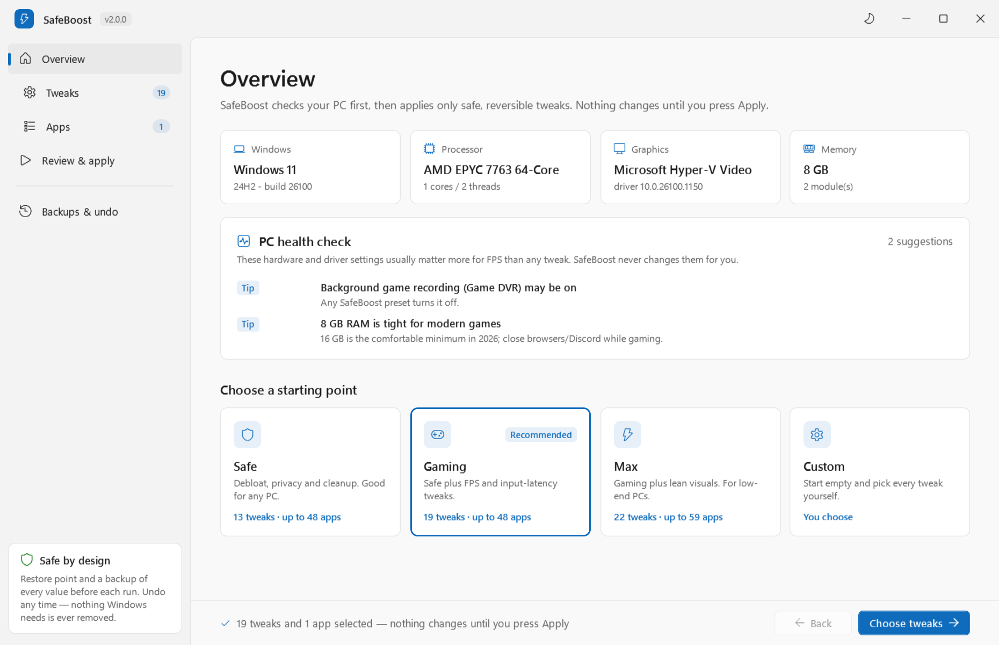
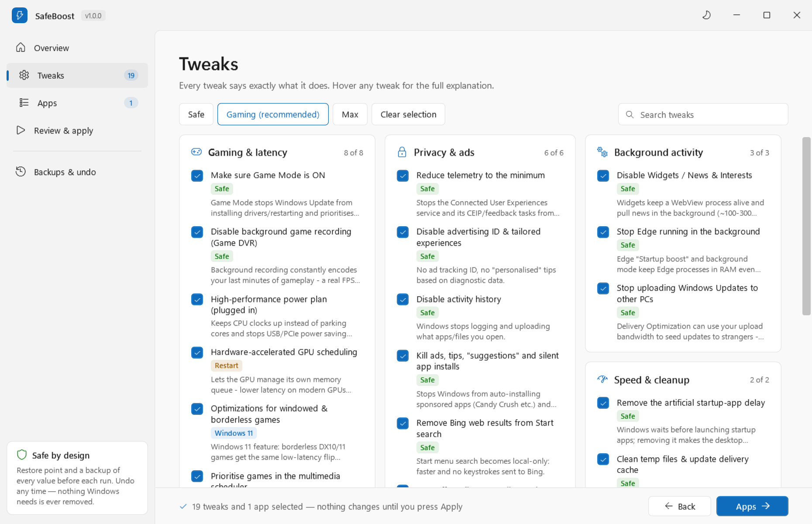
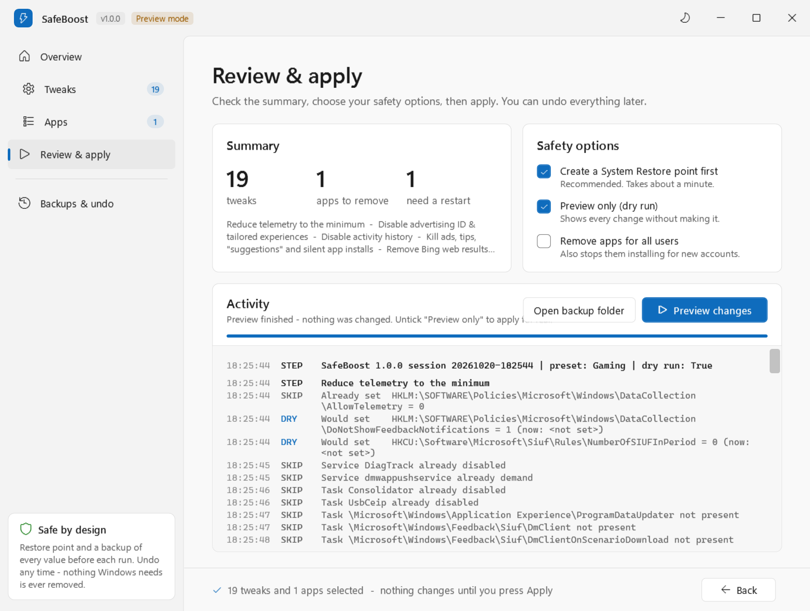
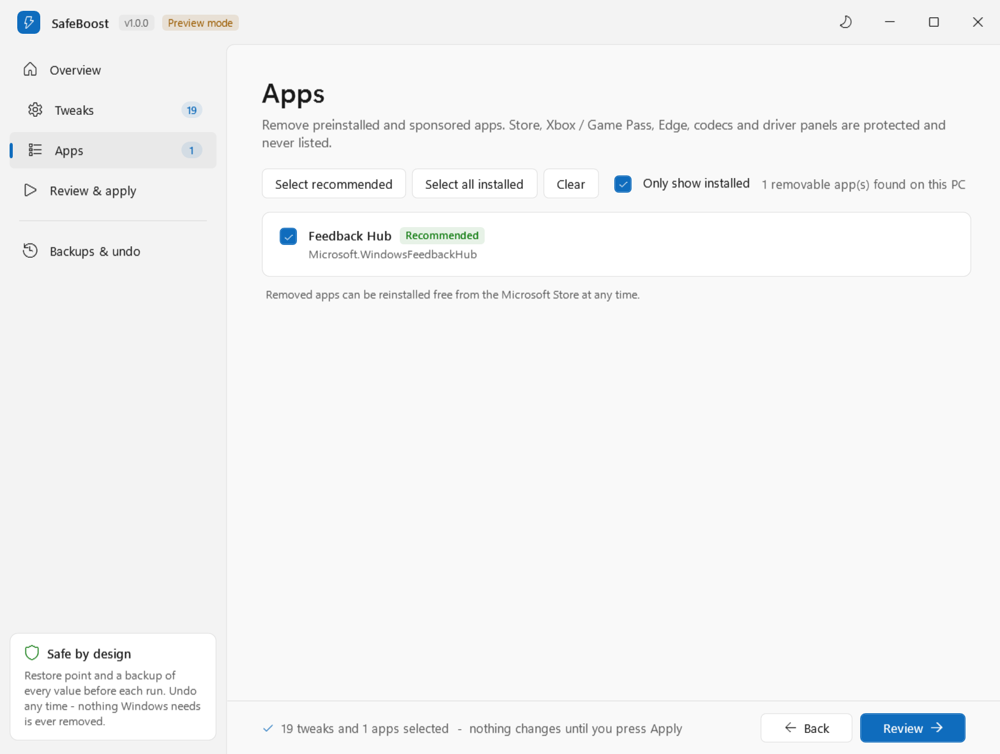
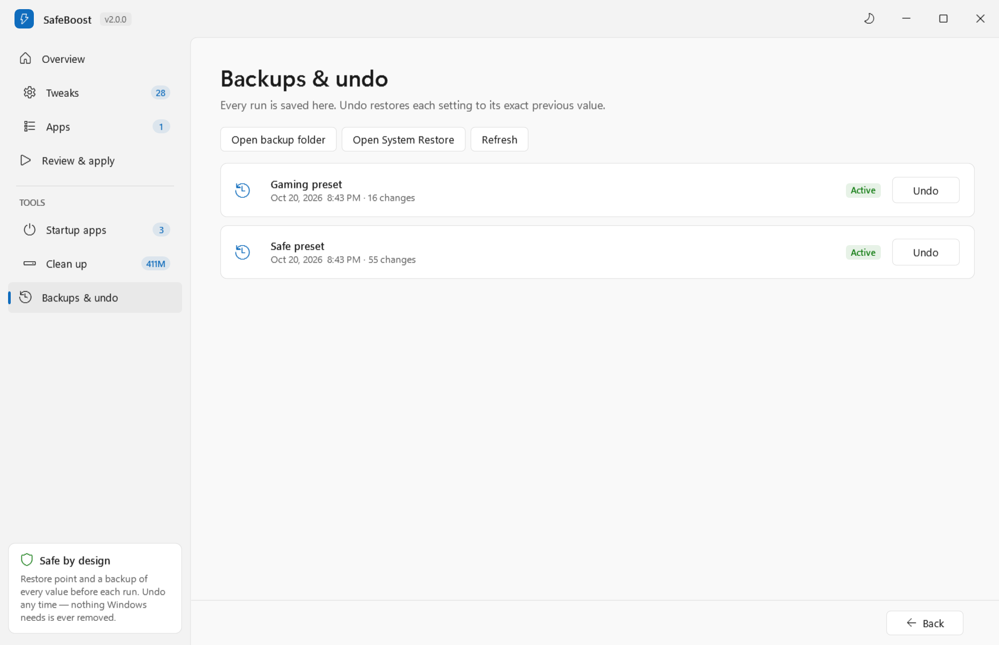
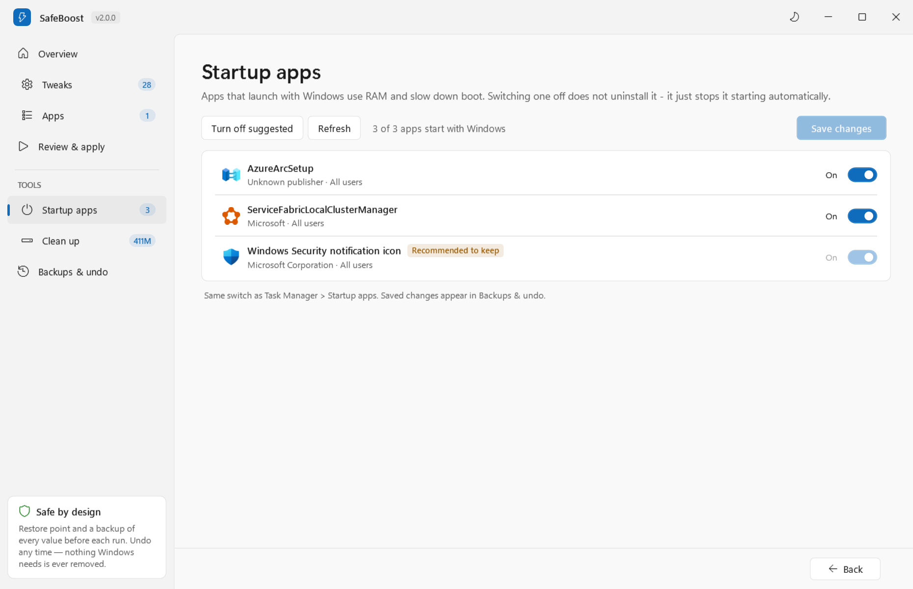
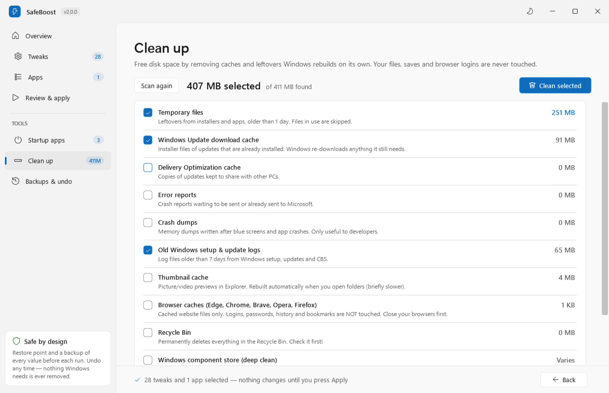

# SafeBoost

**Safe, fully reversible Windows 10 / 11 debloat + gaming performance app.**
Inspired by [Raphire/Win11Debloat](https://github.com/Raphire/Win11Debloat), rebuilt around one rule: **never brick the PC, and every change can be undone.**

<picture>
  <source media="(prefers-color-scheme: dark)" srcset="docs/screenshots/overview-dark.png">
  
</picture>

<table>
  <tr>
    <td width="50%"><picture>
  <source media="(prefers-color-scheme: dark)" srcset="docs/screenshots/tweaks-dark.png">
  
</picture><br><b>Tweaks</b> &mdash; every tweak explains what it does, with Restart / Windows 11 / Safe badges and search.</td>
    <td width="50%"><picture>
  <source media="(prefers-color-scheme: dark)" srcset="docs/screenshots/apply-dark.png">
  
</picture><br><b>Review &amp; apply</b> &mdash; restore point, preview mode and a live, colour-coded log of every change.</td>
  </tr>
  <tr>
    <td width="50%"><picture>
  <source media="(prefers-color-scheme: dark)" srcset="docs/screenshots/apps-dark.png">
  
</picture><br><b>Apps</b> &mdash; Store bloat that is actually installed, plus every desktop program sorted by size with an Uninstall button. Store, Xbox, Edge, drivers and runtimes are protected.</td>
    <td width="50%"><picture>
  <source media="(prefers-color-scheme: dark)" srcset="docs/screenshots/undo-dark.png">
  
</picture><br><b>Backups &amp; undo</b> &mdash; every run listed; one click restores each setting to its exact previous value.</td>
  </tr>
  <tr>
    <td width="50%"><picture>
  <source media="(prefers-color-scheme: dark)" srcset="docs/screenshots/startup-dark.png">
  
</picture><br><b>Startup apps</b> &mdash; switch off apps that launch with Windows (same switch as Task Manager, undoable).</td>
    <td width="50%"><picture>
  <source media="(prefers-color-scheme: dark)" srcset="docs/screenshots/cleanup-dark.png">
  
</picture><br><b>Clean up</b> &mdash; see exactly how much space temp files, update caches, dumps and browser caches use, then free it.</td>
  </tr>
</table>

<sub>Screenshots are rendered from the real app by GitHub Actions on every change (light or dark matches your GitHub theme).</sub>

---

## Quick start

1. **Code &rarr; Download ZIP**, unzip anywhere.
2. Double-click **`Run.bat`** and accept the admin prompt. The SafeBoost app opens.
3. Read the **PC health check** on the Overview page &mdash; it finds what *actually* costs you FPS.
4. Pick **Gaming**, review the tweaks and apps, then **Review &amp; apply** (tick *Preview only* first if you want to see every change without making it).
5. Restart.

Changed your mind? **Backups &amp; undo** in the app, or double-click **`Undo.bat`**.

Prefer a terminal? **`RunConsole.bat`** opens the text menu, and `SafeBoost.ps1` has a full command line (see below).

---

## Everything it can do

**55 tweaks** in 7 groups, each with a plain-English explanation:

| Group | Highlights |
|---|---|
| Gaming & latency | Game Mode on, Game DVR off, high-performance power plan, GPU scheduling, windowed-game optimizations, game scheduler priority, raw mouse input, no Sticky/Filter/Toggle Keys popups, **no surprise update restarts mid-match** (updates still install), background power throttling off |
| Privacy & ads | Telemetry minimum, ad ID, activity history, ads/tips/silent app installs, Bing in Start, Copilot & Recall, typing/handwriting & online speech data, app-launch tracking, Cortana, Edge sidebar/shopping, error-report uploads, location |
| Background activity | Widgets, Edge background mode, P2P update uploads, Store auto-updates, print spooler, search indexing, Fax / retail demo services |
| Disk space | Hibernation file (3-13 GB), reserved storage (~7 GB), CompactOS (2-5 GB), Storage Sense |
| Lean mode | Lighter visual effects, Store apps blocked in background, maps service on demand |
| Speed & cleanup | No startup-app delay, temp-file cleanup |
| Taskbar & Explorer | File extensions, hidden files, open to This PC, hide recent files, Task View / Chat / search box, left-aligned taskbar, dark mode, End task, classic right-click menu |

**Tools**

- **Startup apps** &mdash; every app that launches with Windows, with its icon and publisher, tagged *Safe to disable* (game launchers, chat apps, updaters) or *Recommended to keep* (security, audio, touchpad). Uses Task Manager's own switch, nothing is deleted, and changes are undoable.
- **Clean up** &mdash; temp files, Windows Update cache, Delivery Optimization cache, error reports, crash dumps, old logs, thumbnail cache, browser caches, Recycle Bin and a deep DISM component clean, each with its size. Never touches your files, saves, browser logins or shader caches.
- **Installed programs** &mdash; all desktop programs biggest-first, preinstalled trialware flagged (McAfee, Norton, OEM promos, Office trials...), drivers and runtimes marked *Keep* with no uninstall button.
- **92 Store-app patterns** for bloat removal (sponsored games, Bing apps, promos), with a protected list the engine refuses to cross.

---

## What makes it different

| | Typical "FPS booster" / debloat script | SafeBoost |
|---|---|---|
| Backup | Maybe a restore point | Restore point **+** per-value JSON backup **+** `.reg` export of every touched key |
| Undo | "Use System Restore" | `Undo.bat` puts back the *exact* previous value of every setting (or deletes it if it didn't exist) |
| Crash mid-run | Half-applied mess | Backup file is written after **every single change**, so undo still works |
| Interface | Console text, or a basic form | Windows 11 style app with light/dark theme, search, live log, and a background worker so it never freezes |
| Preview | No | *Preview only* / `-DryRun` shows every value it would change, current vs new |
| Diagnostics | No | Read-only analyzer finds wrong refresh rate, RAM without XMP/EXPO, single-channel RAM, missing/old GPU drivers, HDD boot drive, power saver, battery mode, background hogs |
| App removal | Big regex lists that sometimes eat the Store, Xbox or drivers | Curated list + a **protected list** the engine refuses to cross (Store, App Installer/winget, Xbox/Game Pass, Defender UI, Edge, codecs, GPU/audio/OEM control panels, Calculator, Photos, Notepad, Paint...) |
| Services | Disables dozens of services | Touches a handful, most only if you tick them (telemetry, maps, fax, print spooler, indexing). Update/Defender/audio/network/Xbox services are hard-blocked in code |
| Placebo tweaks | bcdedit timers, "RAM cleaners", Nagle/TCP hacks, disabling Spectre mitigations | **None.** Each tweak has a written reason and does something measurable |
| Testing | - | CI applies *every* tweak on a real Windows VM (98 changes), undoes it, and fails if a single value differs from before; startup toggles, cleanup and the programs list are tested too |
| Wrong account | Silently tweaks the admin account | Warns if you elevated as a different user than the one signed in |

---

## Presets

**SAFE** (any PC) - telemetry minimised, ads/tips/silent app installs off, Bing out of Start search, Copilot & Recall off, Widgets off, Edge stops running in the background, no P2P update uploading, no startup-app delay, Game Mode ON, background game recording OFF, temp-file cleanup, bloat apps removed.

**GAMING** (recommended) - SAFE plus: high-performance power plan for plugged-in use (no USB/PCIe power-saving stutter), hardware-accelerated GPU scheduling, Win11 windowed/borderless game optimizations, games prioritised in the multimedia scheduler, mouse acceleration off, Sticky Keys popup off.

**MAX** (low-end PCs) - GAMING plus: lean visual effects (keeps smooth fonts & thumbnails), Store apps blocked from background activity, offline maps service on-demand, extra app removal (Mail & Calendar, Outlook (new), Phone Link, OneNote, Teams, Spotify/Netflix stubs...).

**CUSTOM** - tick exactly what you want. Includes extras: show file extensions, "End task" on taskbar, classic right-click menu.

See every tweak: `.\SafeBoost.ps1 -ListTweaks`. All of them live as plain data in [`lib/Tweaks.ps1`](lib/Tweaks.ps1).

---

## Honest expectations

No script makes a PC "1000x faster". Here is what to realistically expect:

- **Debloat + background tweaks:** less RAM and CPU used at idle, fewer background spikes, smoother frame times / fewer stutters. Average FPS gain is usually small (0-10%) - it's bigger on weak PCs with lots of junk running.
- **The big wins are usually hardware/driver settings** that no script can safely change for you, which is why the analyzer exists:
  - Monitor stuck at 60 Hz when it supports 144 Hz+
  - RAM running without **XMP/EXPO** (BIOS setting) - often +5-15% FPS
  - **Single-channel** RAM (one stick) - a second stick often gives +10-30% in CPU-heavy games
  - No real GPU driver ("Microsoft Basic Display Adapter") or a very old one
  - Laptop on battery / power-saver plan
  - Windows on a hard drive instead of an SSD

---

## Command line

```powershell
.\SafeBoost.ps1                                   # menu
.\SafeBoost.ps1 -Analyze                          # read-only report
.\SafeBoost.ps1 -Preset Gaming -DryRun            # preview
.\SafeBoost.ps1 -Preset Gaming -Silent            # no prompts
.\SafeBoost.ps1 -Preset Max -Exclude visualfx,apps
.\SafeBoost.ps1 -Preset Custom -Only gamedvr,hags,powerplan,apps
.\SafeBoost.ps1 -Preset Safe -AllUsersApps        # also remove apps for every user + new users
.\SafeBoost.ps1 -Preset Gaming -NoAppRemoval      # tweaks only

.\Restore.ps1                                     # pick a run to undo
.\Restore.ps1 -Latest -Silent
.\Restore.ps1 -All
```

Backups and logs: `C:\ProgramData\SafeBoost\backups\<date-time>\` (`changes.json`, `log.txt`, `before.json`, `reg\*.reg`).

---

## What SafeBoost will NEVER do

- Disable Windows Update, Defender, SmartScreen, UAC, the firewall or CPU security mitigations
- Remove Microsoft Store, App Installer (winget), Edge, WebView2, Xbox / Game Pass components, codecs or driver control panels
- Edit boot configuration (`bcdedit`) or the page file
- Delete your files, downloads or recycle bin
- Change Memory Integrity / Core Isolation (the analyzer tells you about it; the choice is yours)
- Disable your startup apps for you (the analyzer lists them; you decide in Task Manager)

## Undo notes

- Registry settings, services, scheduled tasks and the power plan are restored exactly.
- **Removed apps** can't be "un-removed" by a script reliably - reinstall any of them free from the Microsoft Store. (System Restore points don't bring back Store apps either.)
- Last-resort safety nets: the `.reg` files in the backup folder, or **Win+R -> `rstrui`** and choose the "SafeBoost" restore point.

## Requirements

Windows 10 2004 (build 19041) or newer, or Windows 11. Administrator rights. Windows PowerShell 5.1 and .NET Framework WPF (both built into Windows; if you start it from PowerShell 7 it relaunches itself in 5.1 automatically).

## Credits & license

Inspired by [Win11Debloat](https://github.com/Raphire/Win11Debloat) by Raphire (MIT). SafeBoost is an independent rewrite. MIT licensed - see [LICENSE](LICENSE). Use at your own risk; you are responsible for changes to your PC.
